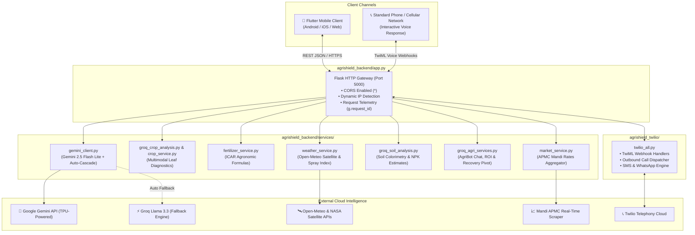

# AgriShield AI — Backend Architecture & Complete Technical Specification

> **Subsystem**: AgriShield Python REST Backend Microservice  
> **Runtime**: Python 3.11+ / Flask 3.0.3  
> **Primary AI Engine**: Google Gemini 2.5 Flash Lite (`gemini-3-flash-preview` / `gemini-2.5-flash-lite`)  
> **Fallback AI Engine**: Google Gemini 3.5 Flash Lite (`gemini-3.5-flash-lite`) & Groq Llama 3.3  
> **Agronomic Standard**: Indian Council of Agricultural Research (ICAR) Guidelines  
> **Meteorological Engine**: Open-Meteo & NASA Satellite Data  
> **Telephony Engine**: Twilio Voice IVR & SMS Engine  

---

## 📑 Table of Contents

1. [Executive Overview](#1-executive-overview)
2. [Backend Architecture & Data Flow](#2-backend-architecture--data-flow)
3. [The Central Gateway: `app.py`](#3-the-central-gateway-apppy)
   - [Dynamic IP & Multi-Interface Networking](#dynamic-ip--multi-interface-networking)
   - [Request Lifecycle & Telemetry](#request-lifecycle--telemetry)
   - [CORS & Client Compatibility](#cors--client-compatibility)
4. [In-Depth Service Modules Breakdown](#4-in-depth-service-modules-breakdown)
   - [1. AI Client Engine (`gemini_client.py`)](#1-ai-client-engine-gemini_clientpy)
   - [2. ICAR Fertilizer Prescription Service (`fertilizer_service.py`)](#2-icar-fertilizer-prescription-service-fertilizer_servicepy)
   - [3. Weather & 48-Hour Smart Spray Advisor (`weather_service.py`)](#3-weather--48-hour-smart-spray-advisor-weather_servicepy)
   - [4. Soil Colorimetry & NPK Analysis (`groq_soil_analysis.py`)](#4-soil-colorimetry--npk-analysis-groq_soil_analysispy)
   - [5. Multimodal Crop Disease Classifier (`groq_crop_analysis.py` & `crop_service.py`)](#5-multimodal-crop-disease-classifier-groq_crop_analysispy--crop_servicepy)
   - [6. Advanced Agri-Business Services (`groq_agri_services.py`)](#6-advanced-agri-business-services-groq_agri_servicespy)
   - [7. Mandi APMC Market Price Aggregator (`market_service.py`)](#7-mandi-apmc-market-price-aggregator-market_servicepy)
5. [Telephony & Smart Alert Service (`agrishield_twilio`)](#5-telephony--smart-alert-service-agrishield_twilio)
6. [Complete REST API Reference](#6-complete-rest-api-reference)
7. [Production Deployment & Cloud Configuration](#7-production-deployment--cloud-configuration)
8. [Developer Runbook & CLI Verification](#8-developer-runbook--cli-verification)

---

## 1. Executive Overview

The **AgriShield Backend** is a high-throughput, climate-resilient agricultural decision-support engine. It sits between the Flutter mobile application, feature phones on cellular networks, and external cloud AI and satellite data providers.

### Core Objectives
1. **Sub-second Multimodal Crop Leaf Disease Diagnosis**: Processes camera leaf captures using Google Cloud TPU-accelerated Gemini 2.5 Flash Lite to identify bacterial, fungal, and viral infections with both chemical and organic remedy schedules.
2. **ICAR-Calibrated Fertilizer Optimization**: Translates land acreage and soil test data into stage-by-stage split fertilizer prescriptions (Basal, Vegetative, Flowering), calculating bag requirements for Urea, DAP, MOP, and SSP with exact subsidized cost estimates.
3. **Micro-Climate Spray Window Forecasting**: Combines satellite meteorological telemetry with agronomic wind-drift and rain-washoff models to produce a 48-hour hourly spray suitability schedule.
4. **Soil Colorimetry & Crop Recommendation**: Analyzes soil photos for color and texture, estimates NPK balance, and ranks suitable crops based on expected yield.
5. **Interactive Telephony & IVR**: Dispatches automated phone calls and emergency SMS messages to farmers via Twilio when high-risk infections or extreme weather events occur.
6. **Bilingual Localization**: Delivers all diagnostic advice and chatbot responses natively in **English 🇬🇧** or **Devanagari Hindi (हिंदी) 🇮🇳**.

---

## 2. Backend Architecture & Data Flow



---

## 3. The Central Gateway: `app.py`

[app.py](file:///d:/agrishield%20main%20-%20Copy/agrishield_backend/app.py) is the central WSGI entrypoint that orchestrates the microservice.

### Dynamic IP & Multi-Interface Networking
In local development, developer machines often change Wi-Fi networks (e.g. mobile hotspot, office Wi-Fi, home router). Standard Flask apps bind to `127.0.0.1` or print hardcoded IP strings that break mobile connectivity.

[app.py](file:///d:/agrishield%20main%20-%20Copy/agrishield_backend/app.py) incorporates a dynamic socket probe:
```python
def get_local_ip():
    """Detect the active local LAN / Wi-Fi IP address."""
    try:
        s = socket.socket(socket.AF_INET, socket.SOCK_DGRAM)
        s.settimeout(0.5)
        # Connects to external IP; queries OS routing table without sending traffic
        s.connect(("8.8.8.8", 80))
        local_ip = s.getsockname()[0]
        s.close()
        return local_ip
    except Exception:
        try:
            return socket.gethostbyname(socket.gethostname())
        except Exception:
            return "127.0.0.1"
```
When starting the server on `0.0.0.0:5000`, it broadcasts:
- `http://127.0.0.1:5000` (Local host & USB adb-reverse)
- `http://<local_ip>:5000` (Active physical Wi-Fi IP)

### Request Lifecycle & Telemetry
Every incoming HTTP request is intercepted by Flask lifecycle hooks:
- **`@app.before_request`**:
  - Captures start timestamp (`time.time()`).
  - Generates a unique 10-character hexadecimal tracking ID: `g.request_id = uuid.uuid4().hex[:10]`.
- **`@app.after_request`**:
  - Calculates execution latency in milliseconds.
  - Appends `X-Request-ID` to response headers.
  - Formats access logs with HTTP method, endpoint, status code, and latency.

### CORS & Client Compatibility
To prevent cross-origin issues across Flutter Web, Android emulators, and physical phones, `Flask-CORS` is configured with wildcard allowance:
```python
CORS(app, resources={r"/*": {"origins": "*"}})
```
Additionally, on Windows platforms, terminal streams are reconfigured to UTF-8 to prevent emoji crash bugs (`sys.stdout.reconfigure(encoding='utf-8', errors='replace')`).

---

## 4. In-Depth Service Modules Breakdown

### 1. AI Client Engine (`gemini_client.py`)

[gemini_client.py](file:///d:/agrishield%20main%20-%20Copy/agrishield_backend/services/gemini_client.py) is the dedicated client for **Google Gemini 2.5 Flash Lite**.

#### Model Selection & Auto-Fallback Cascade
```python
GEMINI_PRIMARY_MODEL  = os.getenv("GEMINI_MODEL", "gemini-3-flash-preview")
GEMINI_FALLBACK_MODEL = os.getenv("GEMINI_FALLBACK_MODEL", "gemini-3.5-flash-lite")

GEMINI_MODEL_CASCADE = [
    GEMINI_PRIMARY_MODEL,
    GEMINI_FALLBACK_MODEL,
    "gemini-3-flash-preview",
    "gemini-3.5-flash-lite",
    "gemini-3.1-flash-lite",
    "gemini-2.5-flash-lite",
]
```
If the primary model returns HTTP 429 (quota rate-limit), HTTP 503 (temporary high demand), or HTTP 404 (deprecated identifier), the client automatically iterates through `GEMINI_MODEL_CASCADE` before falling back to Groq Cloud Llama 3.3.

#### Connection Resilience (Fix for Windows TCP Resets)
Network sockets on Windows frequently experience TCP resets (`wsarecv 10054`). [gemini_client.py](file:///d:/agrishield%20main%20-%20Copy/agrishield_backend/services/gemini_client.py) constructs a resilient `requests.Session` with an `HTTPAdapter` implementing exponential backoff:
```python
retries = Retry(
    total=3,
    backoff_factor=0.6,
    status_forcelist=[429, 500, 502, 503, 504],
    raise_on_status=False,
)
adapter = HTTPAdapter(max_retries=retries, pool_connections=10, pool_maxsize=10)
_session.mount("https://", adapter)
_session.mount("http://", adapter)
```

#### Multimodal Image Handling & JSON Parsing
1. Encodes binary image files to Base64 strings.
2. Injects system instructions enforcing strict valid JSON output without preamble or conversational text.
3. Uses `extract_json_object` and `_repair_truncated_json_object` regex patterns to clean markdown formatting (````json ... ````) and repair unbalanced brackets if responses are truncated.

---

### 2. ICAR Fertilizer Prescription Service (`fertilizer_service.py`)

[fertilizer_service.py](file:///d:/agrishield%20main%20-%20Copy/agrishield_backend/services/fertilizer_service.py) provides precision fertilizer calculation based on Indian Council of Agricultural Research (ICAR) agronomic recommendations.

#### Supported Land Units
Normalizes all land measurements to standard Indian acres:
- **1 Acre** = `1.0 Acre`
- **1 Bigha** = `0.333 Acre` (Standard Central/North India: 3 Bigha = 1 Acre)
- **1 Hectare** = `2.471 Acres`
- **1 Guntha** = `0.025 Acre` (Maharashtra/Gujarat: 40 Guntha = 1 Acre)

#### Split Dosage Formulation
Rather than applying all chemical fertilizers at sowing, the service calculates stage-specific applications:
1. **Basal Application (At Sowing / Day 0-5)**:
   - Primary requirement: Phosphorus (P) for early root development and Potassium (K) for cellular strength.
   - Prescribes **DAP (18:46:0)**, **MOP (0:0:60)**, and **Zinc Sulphate (21%)**.
   - *Agronomic rule*: Chemical Urea is restricted at this stage to avoid nitrogen leaching before seed germination.
2. **First Top Dressing (Vegetative / CRI Stage / Day 20-25)**:
   - Prescribes **Neem Coated Urea (46% N)** + **90% WDG Sulphur** applied post-irrigation when soil moisture is optimal.
3. **Second Top Dressing (Tillering / Day 40-45)**:
   - Second split dose of Neem Coated Urea.
4. **Foliar Nutrition (Booting & Flowering / Day 65-75)**:
   - Soluble **19:19:19 NPK** foliar spray applied late afternoon (after 3:00 PM) to boost grain size, luster, and earhead weight.

#### Bag Count & Subsidized Cost Calculation
Translates elemental requirements into commercial bags based on official Indian subsidized MRPs:
- **Neem Coated Urea (45 kg bag)**: `₹266.50`
- **DAP (50 kg bag)**: `₹1350.00`
- **MOP (50 kg bag)**: `₹1700.00`
- **Zinc Sulphate**: `₹75.00 / kg`
- **Soluble Foliar NPK**: `₹160.00 / kg`

---

### 3. Weather & 48-Hour Smart Spray Advisor (`weather_service.py`)

[weather_service.py](file:///d:/agrishield%20main%20-%20Copy/agrishield_backend/services/weather_service.py) integrates real-time satellite meteorology via the **Open-Meteo API** (free, low-latency, zero rate-limit, no API key required).

#### Parameters Captured
- Current 2m Temperature (`temperature_2m`)
- Relative Humidity (`relative_humidity_2m`)
- Precipitation & Rain Intensity (`precipitation`)
- 10m Wind Speed (`wind_speed_10m`)
- WMO Weather Codes (translated into English and Hindi)
- Solar Radiation (converted from MJ/m² to kWh/m²)

#### The 48-Hour Hourly Spray Suitability Algorithm
Computes an hourly safety classification (`Safe / Caution / Unsafe`) based on 4 meteorological thresholds:

| Condition | Threshold | Classification | Agronomic Rationale |
| :--- | :--- | :--- | :--- |
| **Wind Speed** | `< 5 km/h` | **Caution** | Atmospheric inversion risk: fine droplets hang in air and do not settle on crop canopy. |
| **Wind Speed** | `5 - 15 km/h` | **Safe (Optimal)** | Excellent canopy penetration, minimal lateral drift. |
| **Wind Speed** | `15 - 25 km/h` | **Caution** | Moderate chemical drift towards non-target crops or water bodies. |
| **Wind Speed** | `> 25 km/h` | **Unsafe** | Severe chemical drift; chemical wasted, high environmental risk. |
| **Rain Risk** | `> 30%` or `> 0.5 mm` | **Unsafe** | Rain washoff: chemical washes off foliage before systemic absorption. |
| **High Heat** | `> 35°C` | **Caution / Unsafe** | Rapid droplet evaporation; high chemical concentration scorches foliage. |
| **Low Humidity**| `< 40%` | **Caution** | Water carrier evaporates prematurely, leaving crystal residue. |

---

### 4. Soil Colorimetry & NPK Analysis (`groq_soil_analysis.py`)

[groq_soil_analysis.py](file:///d:/agrishield%20main%20-%20Copy/agrishield_backend/services/groq_soil_analysis.py) applies computer vision to soil sample images:
1. **Verification Guard**: Detects whether the photo is actually agricultural soil (`is_soil: true/false`). Rejects photos of people, animals, buildings, or text.
2. **Soil Classification**: Classifies color and texture into major Indian soil categories:
   - **Black Cotton Soil** (Regur): High clay, high moisture retention, rich in Iron, Lime, Calcium, Magnesium.
   - **Alluvial Soil**: Highly fertile, balanced loam, rich in Potash, deficient in Nitrogen.
   - **Red & Yellow Soil**: Rich in Iron, porous, slightly acidic, low in Nitrogen and Phosphorus.
   - **Laterite Soil**: Acidic, heavy leaching, rich in Iron oxide, low in organic matter.
   - **Sandy Soil**: High porosity, low moisture retention, requires frequent light irrigation.
3. **Nutrient Estimation**: Estimates N-P-K balances (Low, Medium, High), pH level (e.g. 6.5 - 7.2), and organic carbon content.
4. **Crop Recommendation**: Generates the top 5 highest-yielding crop recommendations tailored to the observed soil characteristics.

---

### 5. Multimodal Crop Disease Classifier (`groq_crop_analysis.py` & `crop_service.py`)

Handles leaf image disease detection via cloud AI with offline fallback:
- **Cloud Multimodal Vision** ([groq_crop_analysis.py](file:///d:/agrishield%20main%20-%20Copy/agrishield_backend/services/groq_crop_analysis.py) & [gemini_client.py](file:///d:/agrishield%20main%20-%20Copy/agrishield_backend/services/gemini_client.py)):
  - Analyzes high-resolution leaf photos.
  - Identifies crop type and pathology (e.g., *Early Blight (Alternaria solani)*, *Yellow Rust (Puccinia striiformis)*, *Powdery Mildew*).
  - Determines damage severity percentage (`0 - 100%`).
  - Prescribes **organic remedies** (Neem oil 1500 PPM, Trichoderma viride, Cow urine extract) and **chemical remedies** (Mancozeb 75% WP, Chlorothalonil, Imidacloprid).
- **Offline CNN Classification** ([crop_service.py](file:///d:/agrishield%20main%20-%20Copy/agrishield_backend/services/crop_service.py)):
  - Employs a local TensorFlow/Keras convolutional model (`crop_model.h5`) trained on 38 plant disease classes when cloud connectivity is unavailable.

---

### 6. Advanced Agri-Business Services (`groq_agri_services.py`)

[groq_agri_services.py](file:///d:/agrishield%20main%20-%20Copy/agrishield_backend/services/groq_agri_services.py) provides financial modeling and crisis recovery:

#### 1. AgriBot AI Assistant (`agri_chat`)
- Conversational assistant with agricultural domain constraints.
- Responds in natural, fluent Devanagari Hindi or English based on client locale.
- Advises on pest management, irrigation schedules, market trends, and organic farming techniques.

#### 2. Crisis Recovery Advisor (`get_recovery_advice`)
- Triggered when crop damage exceeds 50%.
- Formulates alternative business pivot plans to prevent financial ruin:
  - **Poultry Farming**: 30-day setup, ₹25,000 investment, ₹15,000/month return.
  - **Oyster Mushroom Cultivation**: 20-day setup, ₹12,000 investment, ₹10,000/month return.
  - **Vermicompost Production**: 45-day setup, ₹15,000 investment, ₹8,000/month return.
  - **Beekeeping (Apiculture)**: 60-day setup, ₹20,000 investment, ₹12,000/month return.

#### 3. Seasonal Farm ROI Calculator (`calculate_roi`)
- Computes economic feasibility:
  $$\text{Total Production Cost} = \text{Seed Cost} + \text{Fertilizer Cost} + \text{Pesticide Cost} + \text{Labor} + \text{Irrigation}$$
  $$\text{Gross Revenue} = \text{Expected Yield (Quintals)} \times \text{Modal Mandi Price}$$
  $$\text{Net Profit} = \text{Gross Revenue} - \text{Total Production Cost}$$
  $$\text{ROI (\%)} = \left(\frac{\text{Net Profit}}{\text{Total Production Cost}}\right) \times 100$$

---

### 7. Mandi APMC Market Price Aggregator (`market_service.py`)

[market_service.py](file:///d:/agrishield%20main%20-%20Copy/agrishield_backend/services/market_service.py) fetches real-time agricultural commodity prices:
- Queries the SerpAPI Google search engine for live APMC Mandi rates across Madhya Pradesh and national mandis.
- Extracts commodity names, modal price per quintal, market yard location, and price trends.
- Maintains an embedded offline dataset for 10 major commodities (Soybean, Wheat, Maize, Rice, Cotton, Gram, Mustard, Onion, Garlic, Lentils) in case the external API is unreachable.

---

## 5. Telephony & Smart Alert Service (`agrishield_twilio`)

The [agrishield_twilio](file:///d:/agrishield%20main%20-%20Copy/agrishield_twilio) module provides automated telephony for farmers without smartphones:

### Core Functions in `twilio_all.py`
1. **`send_sms(to, body)`**:
   Dispatches SMS alerts via Twilio REST API for urgent weather warnings or confirmed crop infections.
2. **`make_voice_call(to, twiml_url)`**:
   Initiates an outbound phone call connecting the farmer to the interactive voice system.
3. **`generate_welcome_twiml()`**:
   Generates TwiML XML constructing an interactive voice response (IVR) menu:
   ```xml
   <?xml version="1.0" encoding="UTF-8"?>
   <Response>
     <Gather numDigits="1" action="/voice-respond" method="POST">
       <Say language="hi-IN">एग्रीशील्ड में आपका स्वागत है। फसल स्वास्थ्य के लिए 1 दबाएं। मौसम के लिए 2 दबाएं।</Say>
     </Gather>
   </Response>
   ```
4. **`handle_voice_input()`**:
   Evaluates DTMF touch tones and generates spoken advice synthesized via Google Cloud text-to-speech.

---

## 6. Complete REST API Reference

### Health & System Status

#### `GET /`
- **Description**: Returns backend health, active AI engine, and current timestamp.
- **Response**:
  ```json
  {
    "status": "online",
    "service": "AgriShield AI Backend v5.0",
    "ai_engine": "gemini-3-flash-preview",
    "timestamp": "2026-10-25 12:15:00"
  }
  ```

#### `GET /ai-info`
- **Description**: Provides hardware and active model telemetry.
- **Response**:
  ```json
  {
    "status": "Success",
    "data": {
      "provider": "Google Gemini",
      "hardware": "Google Cloud TPU",
      "models": {
        "text": { "id": "gemini-3-flash-preview", "name": "Gemini 2.5 Flash Lite" },
        "vision": { "id": "gemini-3-flash-preview", "name": "Gemini 2.5 Flash Lite Vision" },
        "fallback": { "id": "gemini-3.5-flash-lite", "name": "Gemini 3.1 Flash Lite" }
      }
    }
  }
  ```

---

### Crop Diagnostics & Telemetry

#### `POST /predict`
- **Description**: Analyzes uploaded leaf photo for disease symptoms.
- **Payload**: Multipart form-data: `image` (binary file), `crop_hint` (optional string), `language` (`en` or `hi`).
- **Response**:
  ```json
  {
    "status": "success",
    "crop": "Tomato",
    "disease": "Early Blight (Alternaria solani)",
    "confidence": 0.94,
    "severity": "Moderate",
    "damage_percent": 35,
    "symptoms": ["Dark concentric spots on lower leaves", "Yellow halo around lesions"],
    "organic_remedy": "Spray Neem oil 1500 PPM (5ml/L) and remove infected lower foliage.",
    "chemical_remedy": "Apply Mancozeb 75% WP (2g/L) or Chlorothalonil 75% WP (2g/L)."
  }
  ```

#### `GET /last-scan`
- **Description**: Retrieves cached diagnostic report of the most recent leaf scan.

---

### Agronomic Decision Support

#### `POST /fertilizer-prescription`
- **Description**: Computes ICAR-calibrated fertilizer splits, bag requirements, and costs.
- **Payload**:
  ```json
  {
    "crop": "wheat",
    "area": 3.0,
    "unit": "acre",
    "soil_type": "alluvial"
  }
  ```
- **Response**:
  ```json
  {
    "crop": "Wheat",
    "area_acres": 3.0,
    "total_estimated_cost": 3850.00,
    "bags_summary": {
      "urea_45kg": 6.0,
      "dap_50kg": 3.0,
      "mop_50kg": 1.5
    },
    "stages": [
      {
        "stage_name": "Basal Dressing (At Sowing)",
        "days": "Day 0",
        "fertilizers": ["DAP: 3 Bags (150 kg)", "MOP: 1.5 Bags (75 kg)", "Zinc: 30 kg"]
      },
      {
        "stage_name": "First Irrigation (CRI Stage)",
        "days": "Day 20 - 25",
        "fertilizers": ["Neem Coated Urea: 3 Bags (135 kg)", "Sulphur 90% WDG: 9 kg"]
      }
    ]
  }
  ```

#### `GET /spray-advisor`
- **Description**: Computes 48-hour hourly spray window suitability.
- **Query Params**: `lat=23.18&lon=77.41&language=en`
- **Response**:
  ```json
  {
    "status": "success",
    "hourly_forecast": [
      {
        "time": "08:00 AM",
        "suitability": "Safe",
        "wind_speed": 8.5,
        "rain_prob": 10,
        "temperature": 24.2,
        "reason": "Optimal wind and temperature conditions for chemical uptake."
      },
      {
        "time": "01:00 PM",
        "suitability": "Unsafe",
        "wind_speed": 28.0,
        "rain_prob": 15,
        "temperature": 36.5,
        "reason": "Excessive wind drift (>25 km/h) and droplet evaporation risk."
      }
    ]
  }
  ```

---

### Soil Testing & Crisis Recovery

#### `POST /analyze-soil`
- **Description**: Soil photo analysis for colorimetry and NPK balance.
- **Payload**: Multipart form-data: `image` (binary file), `language` (`en` or `hi`).
- **Response**:
  ```json
  {
    "is_soil": true,
    "soil_type": "Black Cotton (Regur)",
    "soil_type_hindi": "काली मिट्टी",
    "ph_level": "7.2 - 7.8 (Neutral to Slightly Alkaline)",
    "nitrogen_level": "Medium",
    "phosphorus_level": "Low",
    "potassium_level": "High",
    "organic_matter": "Medium",
    "advisory": "Add single super phosphate (SSP) to correct phosphorus deficiency before sowing."
  }
  ```

#### `POST /roi-calculate`
- **Description**: Computes seasonal profit and return-on-investment.
- **Payload**:
  ```json
  {
    "crop": "Soybean",
    "acres": 5,
    "seed_cost": 15000,
    "fertilizer_cost": 12000,
    "pesticide_cost": 8000,
    "irrigation_cost": 5000,
    "labor_cost": 15000
  }
  ```
- **Response**:
  ```json
  {
    "total_investment": 55000,
    "expected_yield_quintals": 45,
    "estimated_gross_income": 218250,
    "net_profit": 163250,
    "roi_percentage": 296.8
  }
  ```

#### `POST /agri-chat`
- **Description**: Bilingual conversational AI query.
- **Payload**:
  ```json
  {
    "message": "गेहूं में पीला रतुआ रोग के क्या लक्षण हैं?",
    "language": "hi"
  }
  ```
- **Response**:
  ```json
  {
    "reply": "पीला रतुआ (Yellow Rust) में पत्तियों पर पीले रंग की धारियां बन जाती हैं और हाथ लगाने पर पीला पाउडर छूटता है। इसके नियंत्रण के लिए प्रोपिकोनाजोल 25% EC (1 मिली/लीटर पानी) का छिड़काव करें।"
  }
  ```

---

## 7. Production Deployment & Cloud Configuration

The repository includes production configuration for cloud deployment on **Render**, **Railway**, or **Heroku**:

### Cloud Entrypoint (`Procfile`)
```procfile
web: gunicorn --config gunicorn.conf.py app:app
```

### WSGI Configuration (`gunicorn.conf.py`)
```python
import os

bind = f"0.0.0.0:{os.getenv('PORT', '5000')}"
workers = int(os.getenv("WEB_CONCURRENCY", "2"))
threads = 4
timeout = 120
keepalive = 5
accesslog = "-"
errorlog = "-"
```

---

## 8. Developer Runbook & CLI Verification

### Starting the Server
```bash
# 1. Open terminal in backend folder
cd "d:\agrishield main - Copy\agrishield_backend"

# 2. Install dependencies
pip install -r requirements.txt

# 3. Start Flask REST API
py app.py
```

### Direct CLI Verification Commands

```bash
# Verify health check
curl -s http://127.0.0.1:5000/

# Verify active AI models
curl -s http://127.0.0.1:5000/ai-info

# Verify spray advisor endpoint
curl -s "http://127.0.0.1:5000/spray-advisor?lat=23.18&lon=77.41"

# Verify ICAR fertilizer prescription
curl -s -X POST http://127.0.0.1:5000/fertilizer-prescription \
  -H "Content-Type: application/json" \
  -d "{\"crop\":\"wheat\",\"area\":2.0,\"unit\":\"acre\"}"

# Verify connected physical Android device over USB
adb reverse tcp:5000 tcp:5000
adb shell "curl -s http://127.0.0.1:5000/ai-info"
```

---

*AgriShield AI Backend v5.0 — Maintained alongside [PROJECT.md](file:///d:/agrishield%20main%20-%20Copy/PROJECT.md) and [FILE_STRUCTURE.md](file:///d:/agrishield%20main%20-%20Copy/FILE_STRUCTURE.md).*
