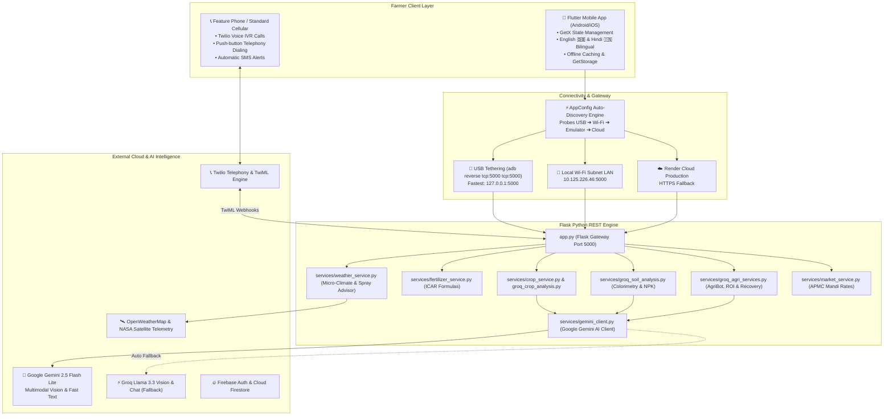
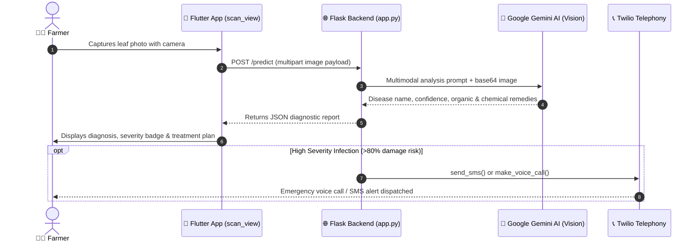
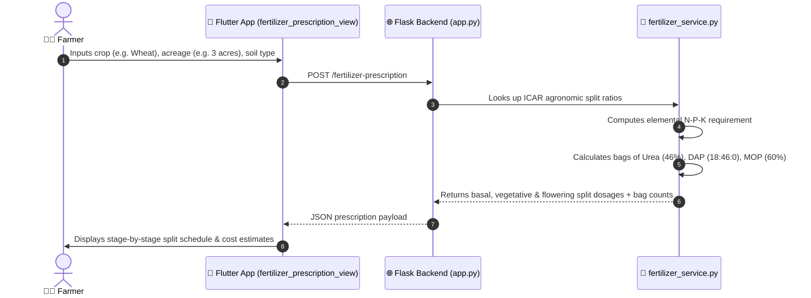
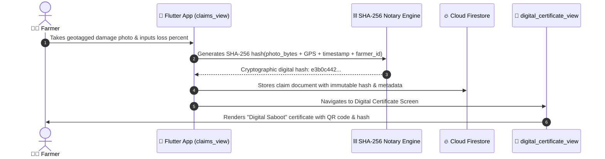

# AgriShield AI — Repository File Structure & Technical Specification

> **Ecosystem**: AI-Powered Climate Resilience, Computer Vision Crop Health & Decentralized Farm Protection  
> **Mobile Client**: Flutter 3.x / Dart 3.x (Bilingual: English 🇬🇧 & Hindi हिंदी 🇮🇳)  
> **Backend Microservice**: Python 3.11+ / Flask REST API (Google Gemini 2.5 Flash Lite Multimodal AI)  
> **Telephony & Smart Alerts**: Twilio Voice IVR & SMS Engine  
> **Cloud & Decentralization**: Firebase Auth/Firestore & Cryptographic SHA-256 Notarization  

---

## 📑 Table of Contents

1. [High-Level Architecture](#high-level-architecture)
2. [Complete Directory Tree](#complete-directory-tree)
3. [Component Breakdown](#component-breakdown)
   - [Root Configuration & Documentation](#1-root-configuration--documentation)
   - [Frontend Mobile Client (`agrishield_app`)](#2-frontend-mobile-client-agrishield_app)
   - [Backend REST Engine (`agrishield_backend`)](#3-backend-rest-engine-agrishield_backend)
   - [Telephony & Smart Alert Service (`agrishield_twilio`)](#4-telephony--smart-alert-service-agrishield_twilio)
4. [Backend REST API Specification](#backend-rest-api-specification)
5. [Frontend-to-Backend Connectivity Architecture](#frontend-to-backend-connectivity-architecture)
6. [Data Flow Diagrams](#data-flow-diagrams)
7. [Environment Variables Reference (`.env`)](#environment-variables-reference-env)
8. [Setup, Build & Execution Runbook](#setup-build--execution-runbook)

---

## High-Level Architecture



---

## Complete Directory Tree

```
agrishield main - Copy/
├── .env                                # Central environment secrets (Gemini, Twilio, Host, Port)
├── FILE_STRUCTURE.md                   # Complete repository file structure & technical guide
├── PROJECT.md                          # Full architectural whitepaper & operational manual
├── README.md                           # Quick-start instructions & high-level overview
├── models.txt                          # Reference list of verified active Gemini models
├── last_scan.json                      # Cached diagnostic metadata of the latest leaf scan
├── pglite-debug.log                    # Local runtime debug log
├── model/                              # Optional directory for exported model weights
├── project_data/                       # Workspace telemetry and operational data store
├── stored_crops/                       # Cached diagnostic images for crop leaves
├── stored_soil/                        # Cached diagnostic images for soil samples
│
├── agrishield_backend/                 # 🐍 Python Flask Backend Microservice
│   ├── .env                            # Backend-specific environment variables
│   ├── .gitignore                      # Python runtime ignores (.pyc, venv, cache)
│   ├── .python-version                 # Pinned Python version (3.11+)
│   ├── Procfile                        # Cloud deployment entrypoint (Render / Heroku)
│   ├── README.md                       # Backend documentation overview
│   ├── app.py                          # 🚀 Primary REST API Gateway & Routing Engine
│   ├── check_models.py                 # CLI diagnostic utility to test Gemini API models
│   ├── crop_model.h5                   # Offline CNN model weights for leaf classification
│   ├── gunicorn.conf.py                # WSGI production server configuration
│   ├── last_scan.json                  # Local mirror of latest crop disease analysis
│   ├── requirements.txt                # Python package dependency definitions
│   │
│   ├── services/                       # 🧠 Core Backend Algorithmic & AI Services
│   │   ├── ai_model_service.py         # AI service abstraction router
│   │   ├── crop_service.py             # Keras/TensorFlow offline CNN leaf inference
│   │   ├── fertilizer_service.py       # ICAR-calibrated NPK & dosage recommendation formulas
│   │   ├── gemini_client.py            # Primary Google Gemini 2.5 Flash Lite client & fallback
│   │   ├── groq_agri_services.py       # AgriBot chat, ROI calculator & recovery logic
│   │   ├── groq_client.py              # Groq Cloud API wrapper for secondary fallback
│   │   ├── groq_crop_analysis.py       # Multimodal crop disease analysis via Groq Vision
│   │   ├── groq_soil_analysis.py       # Soil colorimetry, NPK estimation & crop recommendations
│   │   ├── market_service.py           # Real-time APMC Mandi commodity rates aggregator
│   │   └── weather_service.py          # NASA/OpenWeather micro-climate & spray index analytics
│   │
│   ├── agrishield_twilio/              # Symlink/mirror of Twilio module for cloud deployment
│   ├── stored_crops/                   # Storage folder for uploaded crop analysis photos
│   ├── stored_fields/                  # Storage folder for geotagged field boundary scans
│   └── stored_soil/                    # Storage folder for uploaded soil analysis photos
│
├── agrishield_twilio/                  # 📞 Twilio Voice IVR & Automated Telephony Engine
│   ├── .env                            # Telephony credentials mirror
│   ├── __init__.py                     # Package initialization and public symbol exports
│   ├── call_ai.py                      # Outbound automated call dispatcher with AI speech
│   ├── setup_call.py                   # Twilio phone number configuration & webhook setup
│   ├── test_twilio.py                  # Integration testing suite for SMS and Voice calls
│   └── twilio_all.py                   # Core IVR TwiML generator, SMS formatter & webhook handlers
│
└── agrishield_app/                     # 📱 Flutter Mobile Application (Cross-Platform)
    ├── pubspec.yaml                    # Flutter project configuration, assets & dependencies
    ├── analysis_options.yaml           # Dart analyzer and linting rules
    ├── l10n.yaml                       # Flutter internationalization tool configuration
    │
    ├── android/                        # Android Native Project wrapper
    │   ├── app/
    │   │   ├── build.gradle            # App-level Gradle config (SDK versions, signing)
    │   │   ├── google-services.json    # Firebase Android credentials & project mapping
    │   │   └── src/main/
    │   │       ├── AndroidManifest.xml # Permissions (Camera, Location, Internet)
    │   │       └── res/                # App launcher icons and native XML resources
    │   └── build.gradle                # Project-level Gradle build configuration
    │
    └── lib/                            # 🎯 Core Dart Application Source Code
        ├── main.dart                   # Application entrypoint & backend auto-discovery bootstrap
        ├── firebase_options.dart       # FlutterFire auto-generated initialization settings
        │
        ├── config/                     # Application-Wide Configuration
        │   └── app_config.dart         # Central base URL resolver, timeouts & server dialog
        │
        ├── controllers/                # 🎮 GetX Reactive State Controllers
        │   ├── auth_controller.dart            # Firebase Authentication (Login, Signup, Signout)
        │   ├── blockchain_controller.dart      # Cryptographic SHA-256 claim hash verification
        │   ├── chatbot_controller.dart         # AgriBot voice & text chat state
        │   ├── govt_schemes_controller.dart    # Subsidies & PM schemes data fetching
        │   ├── language_controller.dart        # Bilingual English/Hindi toggle & persistence
        │   ├── market_controller.dart          # APMC Mandi commodity rates state
        │   ├── market_predictor_controller.dart# AI market price trends & forecasts
        │   ├── profile_controller.dart         # Farmer farm metadata & settings state
        │   ├── recovery_controller.dart        # Crop post-disease treatment tracker
        │   ├── reports_controller.dart         # PDF/printable crop & claim reports
        │   ├── roi_controller.dart             # Input investment vs harvest ROI computation
        │   ├── scan_controller.dart            # Camera image capture & leaf diagnosis state
        │   ├── soil_controller.dart            # Soil photo upload, NPK estimates & crop advice
        │   └── weather_controller.dart         # Satellite telemetry & hourly spray score state
        │
        ├── insurance/                  # 🛡️ Decentralized Insurance & Policy Modules
        │   ├── insurance_service.dart  # Claim submission, status checking & notarization
        │   └── policy_service.dart     # Insurance policy catalog & quote calculator
        │
        ├── l10n/                       # 🌐 Bilingual Localization Architecture
        │   ├── app_en.arb              # English translation dictionary
        │   ├── app_hi.arb              # Hindi (हिंदी) translation dictionary
        │   ├── app_localizations.dart  # Generated localization delegate interface
        │   ├── app_localizations_en.dart # Generated English localization implementation
        │   └── app_localizations_hi.dart # Generated Hindi localization implementation
        │
        ├── models/                     # 📦 Typed Data Transfer Objects (DTOs)
        │   ├── claim_model.dart        # Insurance claim structure & blockchain hash metadata
        │   ├── crop_model.dart         # Crop catalog & agronomic attributes
        │   ├── market_model.dart       # APMC Mandi price record
        │   ├── policy_model.dart       # Insurance policy definition & coverage terms
        │   ├── scan_model.dart         # Leaf scan diagnosis result, organic & chemical remedies
        │   ├── soil_model.dart         # Soil analysis result, NPK scores & recommended crops
        │   └── weather_model.dart      # Atmospheric readings & hourly spray forecast
        │
        ├── services/                   # 🔌 Network & Persistence Services
        │   ├── api_service.dart        # HTTP client communicating with Flask backend
        │   └── firestore_service.dart  # Direct Cloud Firestore CRUD for scans & claims
        │
        └── views/                      # 🖼️ Flutter UI Screens (24 Total Views)
            ├── splash_screen.dart                  # Initial animated loading & discovery screen
            ├── home_screen.dart                    # Main dashboard with quick action cards
            ├── login_view.dart                     # Farmer login with email & password
            ├── signup_view.dart                    # Farmer registration screen
            ├── forgot_password_view.dart           # Password reset email submission
            ├── scan_view.dart                      # AI leaf disease camera scanner & diagnosis
            ├── fertilizer_prescription_view.dart   # ICAR fertilizer dosage clinic & bag calculator
            ├── spray_advisor_view.dart             # Smart hourly spray window index (wind/rain)
            ├── weather_view.dart                   # Satellite micro-climate dashboard & 7-day forecast
            ├── weather_screen.dart                 # Secondary weather routing container
            ├── wx.dart                             # Meteorological radar & advanced weather analytics
            ├── claims_view.dart                    # Crop loss insurance claim submission
            ├── buy_policy_view.dart                # Insurance policy selection & premium purchase
            ├── digital_certificate_view.dart       # SHA-256 "Digital Saboot" notarization certificate
            ├── claim_reinvest_view.dart            # Post-claim financial reinvestment guide
            ├── soil_view.dart                      # Soil health testing & crop recommendation
            ├── chatbot_view.dart                   # AgriBot natural language assistant (Voice + Text)
            ├── market_view.dart                    # Real-time APMC Mandi price tracker
            ├── market_predictor_view.dart          # AI commodity price forecasting & trend charts
            ├── govt_schemes_view.dart              # Government subsidies & welfare schemes browser
            ├── recovery_dashboard_view.dart        # Crop disease healing checklist & roadmap
            ├── roi_calculator_view.dart            # Farm seasonal investment & profit calculator
            ├── reports_view.dart                   # Comprehensive farm audit & export reports
            └── profile_view.dart                   # Farmer profile settings & backend server switcher
```

---

## Component Breakdown

### 1. Root Configuration & Documentation

| File | Purpose | Key Details |
| :--- | :--- | :--- |
| **`.env`** | Central configuration file | Contains API keys for Google Gemini, Groq, Twilio, farmer phone numbers, server port, and host. |
| **`PROJECT.md`** | Comprehensive architectural whitepaper | In-depth operational documentation, module deep dives, agronomic formulas, and bilingual architecture. |
| **`FILE_STRUCTURE.md`** | Complete file & directory reference | This document — exhaustive structure, endpoint mappings, and component descriptions. |
| **`README.md`** | Quick-start guide | Concise onboarding instructions for local execution and mobile testing. |
| **`models.txt`** | Gemini models catalogue | Lists verified active Google Gemini models (`gemini-2.5-flash-lite`, `gemini-3.1-flash-lite`, etc.). |
| **`last_scan.json`** | Cache of latest diagnosis | Stores the JSON result of the most recent crop leaf analysis for rapid offline recovery. |

---

### 2. Frontend Mobile Client (`agrishield_app`)

The frontend is a cross-platform mobile application written in Flutter & Dart. It employs **GetX** for reactive state management and route navigation, **GetStorage** for local key-value persistence, and **Flutter Localizations** for 100% native English/Hindi bilingualism.

#### A. Configuration & Bootstrap (`lib/config/`, `lib/main.dart`)
- **`lib/main.dart`**: Initializes Flutter bindings, Firebase, GetStorage, registers the permanent `LanguageController`, and executes `AppConfig.autoDiscoverBackend()`.
- **`lib/config/app_config.dart`**: The single source of truth for networking. Contains URLs for USB adb-reverse (`127.0.0.1:5000`), local Wi-Fi (`10.125.226.46:5000`), emulator (`10.0.2.2:5000`), and production Render. Features `autoDiscoverBackend()` and an in-app `showServerConfigDialog()`.

#### B. Reactive Controllers (`lib/controllers/`)
- **`auth_controller.dart`**: Handles user authentication state via Firebase Auth (`signInWithEmailAndPassword`, `createUserWithEmailAndPassword`, `signOut`).
- **`blockchain_controller.dart`**: Manages cryptographic SHA-256 notarization records, claim hashes, and verifies authenticity against stored tamper-proof records.
- **`chatbot_controller.dart`**: Manages the conversational state of AgriBot, integrating `speech_to_text` for voice queries and calling `/agri-chat`.
- **`govt_schemes_controller.dart`**: Fetches and filters government agricultural welfare schemes from `/govt-schemes`.
- **`language_controller.dart`**: Manages the application locale (`en` or `hi`), persists selection to GetStorage, and updates the entire UI instantly.
- **`market_controller.dart`**: Fetches live APMC Mandi commodity rates from `/mandi-prices`.
- **`market_predictor_controller.dart`**: Retrieves AI-driven commodity price forecast trends from `/market-predictions`.
- **`profile_controller.dart`**: Manages farmer profile attributes (farmer name, farm acreage, primary crops, district).
- **`recovery_controller.dart`**: Fetches actionable recovery step checklists for diagnosed crops from `/recovery-advice`.
- **`reports_controller.dart`**: Aggregates scan logs, fertilizer schedules, and insurance policies into exportable reports.
- **`roi_controller.dart`**: Submits seed, fertilizer, labor, and irrigation costs to `/roi-calculate` and displays estimated revenue and net ROI.
- **`scan_controller.dart`**: Interfaces with `image_picker` to capture or pick leaf photos and submits multipart requests to `/predict`.
- **`soil_controller.dart`**: Handles soil photo capture and NPK inputs, submitting to `/analyze-soil` and `/soil-crop-recommendations`.
- **`weather_controller.dart`**: Fetches satellite weather telemetry and spray advisories from `/weather-advisory` and `/spray-advisor`.

#### C. Data Transfer Objects (`lib/models/`)
- **`claim_model.dart`**: Models insurance claims including farmer ID, crop, damage percent, claim amount, photo URL, and blockchain SHA-256 hash.
- **`crop_model.dart`**: Models crop species, typical diseases, optimal soil pH, and temperature ranges.
- **`market_model.dart`**: Models commodity price data (state, district, market, commodity, min/max/modal prices per quintal).
- **`policy_model.dart`**: Models crop insurance policies (coverage limit, premium per acre, validity dates, terms).
- **`scan_model.dart`**: Models crop disease diagnosis output (crop name, disease name, confidence, symptoms, organic remedies, chemical remedies, severity).
- **`soil_model.dart`**: Models soil analysis output (soil type, estimated N-P-K, pH level, organic carbon, top recommended crops).
- **`weather_model.dart`**: Models atmospheric conditions (temperature, humidity, wind speed, rain probability, hourly spray safety score).

#### D. Networking & Firebase Services (`lib/services/`, `lib/insurance/`)
- **`services/api_service.dart`**: Encapsulates all HTTP calls to the Flask backend using `AppConfig.baseUrl`. Configures connection and request timeouts.
- **`services/firestore_service.dart`**: Provides Firestore database persistence for user profiles, scan histories, and claim records.
- **`insurance/insurance_service.dart`**: Handles insurance claim filing, status polling, and digital certificate generation.
- **`insurance/policy_service.dart`**: Fetches available insurance policies and calculates tailored premium quotes based on land acreage.

#### E. Bilingual Internationalization (`lib/l10n/`)
- **`l10n.yaml`**: Configures Flutter's code generation for internationalization.
- **`app_en.arb`**: Key-value dictionary containing all English UI text.
- **`app_hi.arb`**: Key-value dictionary containing corresponding Hindi (हिंदी) translations.
- **`app_localizations.dart`**: Generated type-safe localization accessor used throughout views (`AppLocalizations.of(context)!`).

#### F. UI Views & Screens (`lib/views/`)
1. **`splash_screen.dart`**: Animated launch screen with logo, status spinner, and background server auto-discovery.
2. **`home_screen.dart`**: Central dashboard displaying micro-climate cards, crop health alerts, live mandi tickers, and quick module navigation.
3. **`scan_view.dart`**: Camera viewfinder and gallery picker for crop leaf disease analysis with severity badges and remedy tabs.
4. **`fertilizer_prescription_view.dart`**: Interactive calculator for crop type, land area, and soil condition; calculates exact split doses of Urea, DAP, MOP, and SSP.
5. **`spray_advisor_view.dart`**: Hourly color-coded spray suitability timeline (Safe / Caution / Unsafe) factoring wind speed and rain probability.
6. **`weather_view.dart` & `wx.dart`**: Detailed satellite weather telemetry, radar maps, humidity charts, and 7-day farming forecasts.
7. **`claims_view.dart`**: Insurance claim filing interface with geotagged photo capture, damage estimation, and policy linking.
8. **`digital_certificate_view.dart`**: Visual representation of the "Digital Saboot" insurance certificate featuring a cryptographic SHA-256 hash and verification QR code.
9. **`buy_policy_view.dart`**: Insurance policy catalog allowing farmers to customize coverage limits and purchase crop insurance.
10. **`claim_reinvest_view.dart`**: Post-claim advisory helping farmers reinvest insurance payouts into optimal replacement seeds and inputs.
11. **`soil_view.dart`**: Computer vision soil analysis screen displaying NPK nutrient bars, pH levels, and top yielding crop recommendations.
12. **`chatbot_view.dart`**: Full-screen bilingual AI agricultural chat interface with speech-to-text voice input.
13. **`market_view.dart`**: Searchable APMC Mandi commodity price explorer with state and district filters.
14. **`market_predictor_view.dart`**: Visual price forecasting charts displaying projected crop prices over the next 30 days.
15. **`govt_schemes_view.dart`**: Comprehensive catalog of government subsidies (PM-KISAN, PMFBY, etc.) with eligibility checks and links.
16. **`recovery_dashboard_view.dart`**: Step-by-step treatment roadmap and healing tracker for previously diagnosed crop diseases.
17. **`roi_calculator_view.dart`**: Financial planning calculator for calculating production costs, expected yield, and net profit margins.
18. **`reports_view.dart`**: Audit log and PDF export generator for farm records, chemical applications, and claim histories.
19. **`profile_view.dart`**: Farmer profile editor with land size settings, language toggle, and backend server configuration modal.
20. **`login_view.dart`**: Authentication screen for returning users.
21. **`signup_view.dart`**: Registration screen for new farmers.
22. **`forgot_password_view.dart`**: Password reset screen.
23. **`weather_screen.dart`**: Container route for weather views.

---

### 3. Backend REST Engine (`agrishield_backend`)

The backend is built with Python 3.11 and Flask, exposing a modular REST API consumed by both the Flutter mobile client and Twilio telephony webhooks.

#### A. Gateway & Routing (`app.py`)
- Configures Flask with CORS support for all origins.
- Dynamically resolves the host's active LAN / Wi-Fi IP using `socket.gethostbyname` to support seamless physical phone connectivity.
- Contains 20+ REST endpoints and error handlers.
- Manages logging and diagnostic request IDs via `g.request_id`.

#### B. Service Modules (`services/`)
- **`gemini_client.py`**:
  - Encapsulates Google Gemini API communication via `google.generativeai` and direct REST fallback.
  - Primary model: `gemini-3-flash-preview` / `gemini-2.5-flash-lite`.
  - Fallback model: `gemini-3.5-flash-lite` / Groq Llama 3.3.
  - Handles multimodal image encoding, prompt construction, and JSON response parsing.
- **`groq_crop_analysis.py`**:
  - Implements multimodal vision analysis of crop leaves using Groq Cloud API when Gemini is rate-limited or offline.
- **`fertilizer_service.py`**:
  - Encapsulates ICAR (Indian Council of Agricultural Research) agronomic standards.
  - Implements split-dosage calculations (Basal, Vegetative, Flowering) for Nitrogen (N), Phosphorus (P), and Potassium (K).
  - Translates elemental nutrients into commercial fertilizer bag counts:
    - **Urea** (46% N)
    - **DAP** (18% N, 46% P₂O₅)
    - **MOP** (60% K₂O)
    - **SSP** (16% P₂O₅, 11% S)
- **`weather_service.py`**:
  - Connects to OpenWeatherMap and NASA satellite APIs.
  - Computes the **Spray Suitability Index**:
    - Wind < 15 km/h: Optimal (low drift)
    - Rain probability < 30%: Optimal (low wash-off)
    - Humidity between 40% and 80%: Optimal
- **`groq_soil_analysis.py`**:
  - Analyzes soil photos for colorimetric classification (Black Cotton, Alluvial, Red, Laterite, Sandy).
  - Estimates N-P-K balances and recommends suitable crops based on soil characteristics.
- **`groq_agri_services.py`**:
  - Manages AgriBot natural language processing with bilingual system prompts.
  - Computes crop recovery timelines and estimated ROI.
- **`market_service.py`**:
  - Aggregates APMC mandi commodity prices across Indian agricultural markets.
- **`crop_service.py`**:
  - Provides offline CNN image classification using local TensorFlow/Keras weights (`crop_model.h5`).

---

### 4. Telephony & Smart Alert Service (`agrishield_twilio`)

The `agrishield_twilio` package provides automated telephony services for farmers who may not possess smartphones or continuous internet connectivity.

- **`twilio_all.py`**:
  - Core integration file holding Twilio credentials and REST client initialization.
  - `send_sms(to_number, body)`: Sends critical alerts (severe disease detections, impending rain warnings) via SMS.
  - `make_voice_call(to_number, twiml_url)`: Initiates automated outbound telephone calls to the farmer.
  - `generate_welcome_twiml()`: Generates interactive voice response (IVR) menus in Hindi and English.
  - `handle_voice_input()`: Parses DTMF touch-tone inputs (e.g., Press 1 for Crop Health, Press 2 for Weather).
- **`call_ai.py`**: Outbound calling script that uses text-to-speech to read diagnosed crop remedies over a phone call.
- **`setup_call.py`**: Configures Twilio phone numbers and sets up webhook URLs for incoming farmer calls.
- **`test_twilio.py`**: Automated test suite verifying SMS dispatch, call initiation, and TwiML XML formatting.

---

## Backend REST API Specification

| Method | Endpoint | Description | Request Payload / Params | Key Response Fields |
| :--- | :--- | :--- | :--- | :--- |
| `GET` | `/` | Backend health check & status | None | `status: "online"`, `version`, `ai_engine` |
| `GET` | `/ai-info` | Active AI models & hardware details | None | `provider`, `models: {text, vision, fallback}` |
| `POST` | `/predict` | Multimodal leaf disease analysis | Multipart `image` file, optional `crop_hint` | `crop`, `disease`, `confidence`, `organic_remedy`, `chemical_remedy`, `severity` |
| `GET` | `/last-scan` | Retrieves cached latest leaf diagnosis | None | Diagnostic JSON from latest `/predict` call |
| `GET` | `/weather-advisory` | Micro-climate metrics & 7-day forecast | Query `lat`, `lon` | `temperature`, `humidity`, `wind_speed`, `forecast` |
| `GET` | `/spray-advisor` | Hourly safe chemical spray window | Query `lat`, `lon` | `hourly_windows: [{hour, suitability, reason}]` |
| `POST` | `/fertilizer-prescription` | ICAR fertilizer dosage & bag calculation | `crop`, `area_acres`, `soil_type`, optional NPK tests | `splits: {basal, vegetative, flowering}`, `bags: {urea, dap, mop}`, `estimated_cost` |
| `GET` | `/mandi-prices` | APMC mandi market commodity prices | Query `state`, `commodity` | `records: [{market, commodity, modal_price, date}]` |
| `POST` | `/analyze-soil` | Soil photo analysis & NPK estimation | Multipart `image` file | `soil_type`, `estimated_npk`, `organic_carbon`, `ph` |
| `POST` | `/soil-crop-recommendations`| Crop recommendations for soil | `soil_type`, `ph`, optional `npk` | `recommended_crops: [{crop, expected_yield, suitability_score}]` |
| `POST` | `/recovery-advice` | Post-disease crop treatment plan | `crop`, `disease`, `severity` | `recovery_steps: [...]`, `timeline_days`, `monitoring_tips` |
| `POST` | `/roi-calculate` | Farm investment vs profit calculator | `crop`, `acres`, `input_costs: {...}` | `total_cost`, `estimated_yield`, `gross_income`, `net_profit`, `roi_percentage` |
| `GET` | `/market-predictions` | AI commodity price trend forecasts | Query `commodity`, `days` | `trend: "bullish"\|"bearish"`, `forecast_points: [...]` |
| `POST` | `/agri-chat` | Bilingual AgriBot conversational query | `message`, `language: "en"\|"hi"`, optional context | `reply`, `suggested_followups` |
| `POST` | `/send-alert` | Dispatches automated SMS or phone call | `phone`, `type: "sms"\|"call"`, `message` | `success: true`, `sid` |
| `GET` | `/alert-history` | Log of previously dispatched alerts | Query `phone` | `alerts: [{id, timestamp, type, status}]` |
| `GET` | `/govt-schemes` | Catalog of agricultural subsidies | Query `category`, `state` | `schemes: [{name, subsidy_amount, eligibility, link}]` |
| `POST` | `/voice-incoming` | Twilio webhook for incoming calls | Twilio webhook form data | TwiML XML response (IVR voice menu) |
| `POST` | `/voice-respond` | Twilio webhook for IVR touch tones | Twilio `Digits` speech payload | TwiML XML response (Selected advisory audio) |

---

## Frontend-to-Backend Connectivity Architecture

The Flutter mobile application uses an intelligent multi-path discovery engine implemented in [AppConfig](file:///d:/agrishield%20main%20-%20Copy/agrishield_app/lib/config/app_config.dart).

```
Mobile App Startup
       │
       ▼
[autoDiscoverBackend()]
       │
       ├─► 1. USB Port Reverse (http://127.0.0.1:5000) ───[Probes in <10ms via adb reverse]───► Connected! 🟢
       │
       ├─► 2. Local Wi-Fi Subnet (http://10.125.226.46:5000) ──[Probes via local LAN router]──► Connected! 🟢
       │
       ├─► 3. Android Emulator (http://10.0.2.2:5000) ────────[Probes emulator virtual router]► Connected! 🟢
       │
       └─► 4. Cloud Render Fallback (https://agrishiedai-backend.onrender.com) ─────────────► Connected! ☁️
```

### Connectivity Modes
1. **USB Port Reverse Mode (`http://127.0.0.1:5000`)**:
   - Primary route when debugging with a physical phone connected over USB.
   - Command: `adb reverse tcp:5000 tcp:5000`
   - Bypasses all Wi-Fi router isolation, firewall restrictions, and IP changes.
2. **Local Wi-Fi Subnet Mode (`http://10.125.226.46:5000`)**:
   - Secondary route when the physical phone is untethered on the same Wi-Fi network as the development PC.
   - Automatically updated when the PC's DHCP IP address changes.
3. **Android Emulator Mode (`http://10.0.2.2:5000`)**:
   - Loopback route mapped to host machine when executing inside the Android SDK emulator.
4. **Cloud Production Fallback (`https://agrishiedai-backend.onrender.com`)**:
   - Production HTTPS server deployed on Render, engaged when local development hosts are offline.
5. **Runtime Server Switcher**:
   - The user can open the **Backend Server Dialog** directly from the mobile app (via the Profile tab) to switch or enter any custom URL at runtime without rebuilding the APK.

---

## Data Flow Diagrams

### 1. Multimodal Crop Leaf Diagnosis Flow



### 2. ICAR Fertilizer Dosage Calculation Flow



### 3. Blockchain Insurance Claim ("Digital Saboot") Flow



---

## Environment Variables Reference (`.env`)

```ini
# =================================================================
# 🌾 AgriShield AI — Environment Secrets & Configuration
# =================================================================

# Google Gemini AI API (Primary Intelligence Provider)
GEMINI_API_KEY=your_gemini_api_key_here
GEMINI_MODEL=gemini-2.5-flash-lite
GEMINI_FALLBACK_MODEL=gemini-2.0-flash-lite

# Groq Cloud API (Secondary Fallback Provider)
GROQ_API_KEY=your_groq_api_key_here

# HuggingFace Token (Optional legacy model downloads)
HF_TOKEN=your_huggingface_token_here

# Twilio Telephony & Smart Alert Service
TWILIO_ACCOUNT_SID=your_twilio_account_sid_here
TWILIO_AUTH_TOKEN=your_twilio_auth_token_here
TWILIO_API_KEY_SID=your_twilio_api_key_sid_here
TWILIO_API_KEY_SECRET=your_twilio_api_key_secret_here
TWILIO_PHONE_NUMBER=+1xxxxxxxxxx

# Farmer Notification Phone Numbers (E.164 format)
FARMER_PHONE_NUMBER=+91xxxxxxxxxx
FARMER_WHATSAPP_NUMBER=+91xxxxxxxxxx

# Flask Backend Server Configuration
PORT=5000
HOST=0.0.0.0
```

---

## Setup, Build & Execution Runbook

### 1. Prerequisites
- **Python**: 3.11 or higher
- **Flutter SDK**: 3.19 or higher / Dart 3.3+
- **Android SDK & ADB**: Installed with platform tools added to PATH
- **Physical Phone**: Android device with USB Debugging enabled

### 2. Backend Startup
```bash
# 1. Navigate to the backend directory
cd "d:\agrishield main - Copy\agrishield_backend"

# 2. Install Python dependencies
pip install -r requirements.txt

# 3. Start the Flask REST server
py app.py
```
*The server will start listening on `0.0.0.0:5000` and automatically display its local Wi-Fi IP.*

### 3. Establish USB ADB Port Forwarding
```bash
# Run this command whenever connecting a physical phone over USB
adb reverse tcp:5000 tcp:5000
```
*Verification*:
```bash
adb shell "curl -s http://127.0.0.1:5000/ai-info"
```

### 4. Frontend Startup
```bash
# 1. Navigate to the frontend directory
cd "d:\agrishield main - Copy\agrishield_app"

# 2. Install Flutter packages
flutter pub get

# 3. Compile localization dictionaries
flutter gen-l10n

# 4. Launch the application on the connected device
flutter run
```

---

*Document generated automatically for AgriShield AI v5.0. Maintained in sync with [PROJECT.md](PROJECT.md).*
