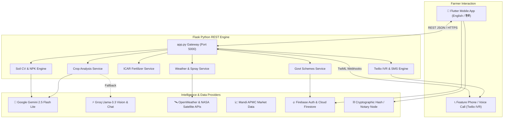

# AgriShield — Comprehensive Project Documentation (PROJECT.md)

[](https://flutter.dev)
[](https://dart.dev)
[](https://python.org)
[](https://flask.palletsprojects.com)
[](https://ai.google.dev)
[](https://groq.com)
[](https://www.twilio.com)
[](#bilingual-localization-architecture)

---

## 📑 Table of Contents

1. [Executive Summary](#executive-summary)
2. [Problem Statement & The AgriShield Solution](#problem-statement--the-agrishield-solution)
3. [System Architecture](#system-architecture)
4. [Technology Stack](#technology-stack)
5. [Core Modules & Features](#core-modules--features)
   - [Multimodal Vision AI Crop Scanner](#1-multimodal-vision-ai-crop-scanner)
   - [ICAR-Calibrated Fertilizer Clinic](#2-icar-calibrated-fertilizer-clinic)
   - [Smart Hourly Spray Advisor](#3-smart-hourly-spray-advisor)
   - [NASA Satellite & Micro-Climate Advisory](#4-nasa-satellite--micro-climate-advisory)
   - [Blockchain Claims & "Digital Saboot"](#5-blockchain-claims--digital-saboot)
   - [Mandi Rates & AI Market Predictor](#6-mandi-rates--ai-market-predictor)
   - [Soil Health & Nutrient Testing](#7-soil-health--nutrient-testing)
   - [AgriBot AI Assistant](#8-agribot-ai-assistant)
   - [Twilio Voice IVR & Automated Alert Engine](#9-twilio-voice-ivr--automated-alert-engine)
   - [Government Subsidies & PM Schemes](#10-government-subsidies--pm-schemes)
6. [Bilingual Localization Architecture](#bilingual-localization-architecture)
7. [Directory Structure](#directory-structure)
8. [Backend REST API Specification](#backend-rest-api-specification)
9. [Installation & Setup Guide](#installation--setup-guide)
10. [Environment Variables Reference](#environment-variables-reference)
11. [Troubleshooting & FAQs](#troubleshooting--faqs)

---

## Executive Summary

**AgriShield** is an advanced, climate-resilient agricultural decision-support and risk-mitigation platform designed specifically for smallholder and commercial farmers. By unifying **Multimodal Computer Vision (Google Gemini 2.5 Flash Lite & Groq Vision)**, **hyper-local micro-climate analytics**, **ICAR agronomic standards**, **cryptographic blockchain insurance notarization**, and **interactive voice response (IVR)**, AgriShield empowers farmers to detect crop threats in seconds, spray chemicals safely, optimize fertilizer costs, receive government subsidies, and settle crop loss insurance claims transparently.

The entire mobile application supports seamless, 100% native bilingual operation in **English 🇬🇧** and **हिंदी (Hindi) 🇮🇳** with instant, zero-restart language switching and local persistence.

---

## Problem Statement & The AgriShield Solution

| Traditional Farming Challenge | AgriShield Solution |
| :--- | :--- |
| **Delayed Disease Detection**: Crop diseases spread silently, destroying up to 40% of yields before visual diagnosis. | **Sub-second Multimodal Vision AI** detects early-stage bacterial, fungal, and viral infections from leaf photos with organic and chemical prescription remedies. |
| **Pesticide Wastage & Chemical Runoff**: Farmers spray without knowing wind drift or upcoming rain, causing chemical loss and soil toxicity. | **Smart Hourly Spray Advisor** computes wind speed, humidity, and rain risk to calculate exact safe application windows. |
| **Over-fertilization & High Input Costs**: Lack of soil science knowledge causes over-application of DAP/Urea, eroding farmer profit margins. | **ICAR-Calibrated Farm Clinic** provides precise basal, vegetative, and flowering split dosages with exact bag counts and price estimations. |
| **Slow, Disputed Insurance Claims**: Traditional crop insurance claims take 6-12 months and frequently get rejected due to lack of proof. | **Blockchain Notarization ("Digital Saboot")** stamps tamper-proof SHA-256 hashes with GPS metadata and automated smart claim pipelines. |
| **Digital Literacy & Language Barriers**: Rural Indian farmers often struggle with English-only, complex digital dashboards. | **Complete Hindi (हिंदी 🇮🇳) UI** throughout the app plus an **Automated Twilio IVR voice calling system** for push-button telephone advisory. |

---

## System Architecture



---

## Technology Stack

### Mobile Frontend (`agrishield_app`)
* **Framework**: Flutter 3.x / Dart 3.x
* **State Management**: GetX (Reactive state, dynamic route management, dependency injection)
* **Local Persistence**: GetStorage (Bilingual language preferences, offline cache)
* **Localization**: Official Flutter `gen-l10n`, `flutter_localizations`, `intl`, ARB files (`app_en.arb`, `app_hi.arb`)
* **Authentication & Database**: Firebase Auth, Cloud Firestore
* **Hardware Integrations**: Camera, Image Picker, Geolocator (GPS tracking for crop notarization)

### Backend Engine (`agrishield_backend`)
* **Framework**: Python 3.11+, Flask 3.0.3, Flask-CORS 4.0.1
* **Server**: Gunicorn 22.0.0 (Production WSGI)
* **AI Client Architecture**:
  * Primary: Google Gemini 2.5 Flash Lite (`gemini-2.5-flash-lite`)
  * Secondary / Fallback: Google Gemini 3.1 Flash Lite (`gemini-3.1-flash-lite`)
  * Groq Vision / Inference (`llama-3.3-70b-versatile`, `llama-3.2-11b-vision-preview`)
* **Weather & Agronomy**: Live OpenWeatherMap API & ICAR Dosage Calibrations

### Telephony & Automated Notification Engine (`agrishield_twilio`)
* **Provider**: Twilio REST API & TwiML
* **Features**:
  * Automated Voice Alerts (Hindi speech synthesis to farmer phones)
  * Two-way IVR voice interaction
  * Emergency Crop Hazard SMS alerts

---

## Core Modules & Features

### 1. Multimodal Vision AI Crop Scanner
* **Camera / Gallery Capture**: Real-time high-resolution leaf and crop image acquisition.
* **Instant Disease Diagnosis**: Identifies over 40+ common crop diseases across Wheat, Rice, Cotton, Tomato, Potato, Soybean, Maize, Mustard, and Sugarcane.
* **Agronomic Advice**:
  * Disease Name & Confidence Score (e.g., *Late Blight 94%*).
  * Symptoms & Root Cause Breakdown.
  * Chemical Cure (Active chemical ingredients, dosage per acre).
  * Organic / Desi Upay (Neem oil, trichoderma, bio-fungicides).
  * Prevention Rules to protect neighboring plots.

### 2. ICAR-Calibrated Fertilizer Clinic
* **Precision Dosages**: Built on Indian Council of Agricultural Research (ICAR) fertilizer dosage matrix.
* **Input Parameters**: Crop selection, field area (Acres / Hectares / Bigha), crop age in days.
* **Output Deliverables**:
  * Exact total bag count for **Urea (45 kg)**, **DAP (50 kg)**, and **MOP (50 kg)**.
  * Estimated total input cost in Indian Rupees (₹).
  * Current Active Stage indicator based on crop age.
  * Three-step split application schedule:
    1. *Basal Dose (Sowing/Planting)*
    2. *Vegetative Stage (First top dressing)*
    3. *Flowering & Grain Filling (Second top dressing)*
  * Organic booster recommendations (Vermicompost, biofertilizers).
  * One-tap WhatsApp Prescription sharing with agri-dealers or family members.

### 3. Smart Hourly Spray Advisor
* **Micro-Climate Risk Engine**: Analyzes wind speed, ambient temperature, relative humidity, and precipitation probability.
* **Safety Classifications**:
  * 🟢 **SAFE**: Optimal absorption, minimal evaporation, zero drift risk.
  * 🟡 **CAUTION**: Borderline conditions; adjust nozzle pressure and spray with caution.
  * 🔴 **DO NOT SPRAY**: High wind (chemical drift risk) or impending rain (wash-off risk).
* **Next Safe Window Calculator**: Automatically projects the next 4-hour window when spraying conditions will be ideal.
* **24-Hour Timeline**: Hour-by-hour forecast with temperature, wind velocity, and rain probability.

### 4. NASA Satellite & Micro-Climate Advisory
* **Satellite Telemetry**: Atmospheric metrics pulled using farmer's live GPS coordinates.
* **Key Indicators**: Temperature, Humidity, Precipitation Risk, Wind Speed, Solar Radiation index.
* **Crop Impact Assessment**:
  * *Vegetative Growth Rate* rating.
  * *Fungal / Pest Disease Risk* based on humidity and dew point.
  * *Irrigation Requirement* (e.g., "Sufficient moisture from rain — delay watering 48 hours").

### 5. Blockchain Claims & "Digital Saboot"
* **Decentralized Crop Loss Verification**:
  * When severe weather or pest infestation damages crops (> 50%), the farmer captures real-time geo-tagged imagery.
  * The app computes an immutable **SHA-256 cryptographic hash** of the diagnostic image, GPS coordinates, timestamp, and disease severity.
  * Generates an official **Digital Saboot Certificate** with a unique Notarization ID.
* **Direct PMFBY / Private Insurance Pipeline**:
  * Auto-generates claim forms for the Pradhan Mantri Fasal Bima Yojana (PMFBY).
  * Prevents fraud, guarantees tamper-proof verification, and accelerates claim settlement timelines.

### 6. Mandi Rates & AI Market Predictor
* **Live APMC Mandi Rates**: Daily real-time prices for major crops across APMC mandis in Madhya Pradesh, Maharashtra, Punjab, Haryana, Rajasthan, Uttar Pradesh, etc.
* **AI Market Forecast**:
  * Price trend trajectory (Bullish 📈 / Bearish 📉 / Stable ⚖️).
  * Expected 30-day price band (Min - Max ₹/Quintal).
  * Harvest & Selling Advisory: Recommends whether to sell immediately or store in warehouse for higher margins.

### 7. Soil Health & Nutrient Testing
* **Computer Vision Soil Analysis**: Analyzes soil texture, color, and structure from field photos.
* **Nutrient Estimation**: Estimates soil class (Clay, Loam, Sandy, Black Cotton), pH range, and N-P-K balance.
* **Plant & Crop Recommendation**: Matches diagnosed soil characteristics with the highest-yielding crop varieties for the current season.

### 8. AgriBot AI Assistant
* **Conversational Agriculture Expert**: Powered by Gemini 2.5 Flash Lite and Groq LLMs.
* **Full Bilingual Voice & Text**: Answers complex agronomy queries in natural Hindi or English.
* **Quick Access Prompts**: Pre-configured one-tap chips for Pest Control, Fertilizer Dosing, Market Prices, and Weather Alerts.

### 9. Twilio Voice IVR & Automated Alert Engine
* **Universal Accessibility for Feature Phones**:
  * Rural farmers who lack smartphones or internet connectivity can dial the AgriShield helpline.
  * **Interactive Voice Response (IVR)** speaks in Hindi and accepts DTMF keypad inputs or voice commands.
* **Automated Emergency Dispatch**:
  * Critical warnings (e.g., locust attacks, hailstorms, flash flood alerts) trigger automated outbound voice calls and SMS alerts directly to registered farmers.

### 10. Government Subsidies & PM Schemes
* **Curated Database of Farmer Welfare Schemes**:
  * Pradhan Mantri Kisan Samman Nidhi (PM-KISAN)
  * Pradhan Mantri Fasal Bima Yojana (PMFBY)
  * PM Kusum Solar Pump Yojana
  * Soil Health Card Scheme
  * Sub-Mission on Agricultural Mechanization (SMAM - Tractor subsidy)
* **Search & Filters**: Search by scheme name, subsidy percentage, eligibility criteria, and direct application links.

---

## Bilingual Localization Architecture

AgriShield implements **Flutter's official native localization standard** (`flutter_localizations` & `gen-l10n`), paired with **GetX** and **GetStorage** for dynamic, zero-restart language updates.

### Localization Workflow

```
lib/l10n/
  ├── app_en.arb   <-- 200+ Master English strings & keys
  └── app_hi.arb   <-- Corresponding natural Hindi (हिंदी) translations
        │
        ▼ (flutter gen-l10n)
lib/l10n/
  ├── app_localizations.dart
  ├── app_localizations_en.dart
  └── app_localizations_hi.dart
        │
        ▼ (Imported by LanguageController)
lib/controllers/language_controller.dart
  ├── currentLocale: 'en' | 'hi'
  ├── changeLanguage('hi' | 'en') --> Get.updateLocale() + GetStorage.write()
  └── context.l10n extension --> AppLocalizations.of(context)!
```

### Key Localization Highlights
1. **Instant Switching**: Changing language in the Profile or AppBar triggers `Get.updateLocale()` immediately without recreating widgets or restarting the app.
2. **Permanent Device Persistence**: The chosen language is stored in `GetStorage` under `'selected_language'`. The app automatically restores the user's preference on subsequent launches.
3. **No Session Loss**: Switching languages preserves user login status, active scan results, and form inputs.
4. **Zero Untranslated Strings**: Over 200 UI strings, labels, hints, metric units, buttons, drawer items, and dialogs are fully localized in natural, easy-to-understand Hindi.

---

## Directory Structure

```
d:/agrishield main - Copy/
├── .env                              # Root environment variables
├── PROJECT.md                        # Master project documentation
├── README.md                         # Project overview and quickstart
├── models.txt                        # Active Gemini AI models reference
│
├── agrishield_backend/               # Python Flask REST API
│   ├── app.py                        # Main Flask server & route gateway
│   ├── requirements.txt              # Python dependencies
│   ├── Procfile                      # Cloud deployment runner
│   ├── gunicorn.conf.py              # WSGI configuration
│   ├── last_scan.json                # Local cache of most recent scan
│   ├── stored_crops/                 # Uploaded crop scan images
│   ├── stored_soil/                  # Uploaded soil scan images
│   ├── project_data/                 # Persistent alert history & records
│   └── services/                     # Business logic services
│       ├── gemini_client.py          # Gemini 2.5 Flash Lite & Groq client
│       ├── fertilizer_service.py     # ICAR fertilizer prescription engine
│       ├── weather_service.py        # OpenWeather & spray advisor service
│       ├── groq_crop_analysis.py     # Vision crop disease detection
│       ├── groq_soil_analysis.py     # Soil CV & NPK estimation
│       ├── groq_agri_services.py     # Recovery, ROI & chatbot services
│       ├── market_service.py         # Mandi APMC rates integration
│       └── ai_model_service.py       # Model health checks & routing
│
├── agrishield_twilio/                # Telephony & Voice Alert Engine
│   ├── __init__.py                   # Package exports
│   ├── twilio_all.py                 # Twilio Client & SMS/Voice dispatch
│   ├── call_ai.py                    # Voice AI response handler
│   ├── setup_call.py                 # Outbound automated calling scripts
│   └── test_twilio.py                # Telephony test harness
│
└── agrishield_app/                   # Flutter Mobile Client
    ├── pubspec.yaml                  # Flutter package dependencies
    ├── l10n.yaml                     # Localization code-generation config
    ├── lib/
    │   ├── main.dart                 # Application entry point & bindings
    │   ├── firebase_options.dart     # Firebase configuration
    │   │
    │   ├── l10n/                     # Official ARB translation catalogs
    │   │   ├── app_en.arb            # English strings
    │   │   ├── app_hi.arb            # Hindi strings (हिंदी)
    │   │   ├── app_localizations.dart
    │   │   ├── app_localizations_en.dart
    │   │   └── app_localizations_hi.dart
    │   │
    │   ├── controllers/              # GetX state management controllers
    │   │   ├── language_controller.dart # Reactive bilingual state & switcher
    │   │   ├── auth_controller.dart     # Firebase user authentication
    │   │   ├── scan_controller.dart     # Camera scan & Vision AI handler
    │   │   ├── weather_controller.dart  # Weather & spray data state
    │   │   ├── blockchain_controller.dart # Claims & Digital Saboot hashing
    │   │   ├── chatbot_controller.dart  # AgriBot bilingual chat controller
    │   │   ├── profile_controller.dart  # User profile & land records
    │   │   ├── govt_schemes_controller.dart
    │   │   ├── market_controller.dart
    │   │   ├── market_predictor_controller.dart
    │   │   ├── recovery_controller.dart
    │   │   ├── reports_controller.dart
    │   │   ├── roi_controller.dart
    │   │   └── soil_controller.dart
    │   │
    │   ├── views/                    # Mobile UI Views & Screens
    │   │   ├── splash_screen.dart    # Animated startup screen
    │   │   ├── login_view.dart       # User sign-in with language picker
    │   │   ├── signup_view.dart      # Farmer registration
    │   │   ├── forgot_password_view.dart
    │   │   ├── home_screen.dart      # Main dashboard & drawer
    │   │   ├── scan_view.dart        # Vision AI crop leaf scanner
    │   │   ├── wx.dart               # NASA Weather & satellite advisory
    │   │   ├── spray_advisor_view.dart # Hourly smart spray planner
    │   │   ├── fertilizer_prescription_view.dart # Farm clinic fertilizer Rx
    │   │   ├── claims_view.dart      # PMFBY & private insurance claims
    │   │   ├── digital_certificate_view.dart # Tamper-proof certificate
    │   │   ├── buy_policy_view.dart  # Micro-insurance policy checkout
    │   │   ├── claim_reinvest_view.dart # Seed & fertilizer reinvestment
    │   │   ├── recovery_dashboard_view.dart # Crop emergency protocol
    │   │   ├── govt_schemes_view.dart# Central/State subsidy catalog
    │   │   ├── market_view.dart      # Real-time Mandi commodity rates
    │   │   ├── market_predictor_view.dart # 30-day AI price forecasts
    │   │   ├── soil_view.dart        # Soil test analysis & camera
    │   │   ├── chatbot_view.dart     # Bilingual AgriBot AI chat
    │   │   ├── reports_view.dart     # Farm history & analytics
    │   │   └── profile_view.dart     # Farmer profile & language settings
    │   │
    │   ├── services/                 # API & Data access services
    │   │   ├── api_service.dart      # HTTP client communicating with backend
    │   │   └── firestore_service.dart# Cloud Firestore integration
    │   │
    │   ├── insurance/                # Insurance & Policy management
    │   │   ├── insurance_service.dart
    │   │   └── policy_service.dart
    │   │
    │   ├── models/                   # Data transfer objects
    │   │   ├── crop_health_model.dart
    │   │   ├── user_model.dart
    │   │   └── weather_model.dart
    │   │
    │   └── config/                   # Global constants & network config
    │       └── app_config.dart
```

---

## Backend REST API Specification

Base URL: `http://127.0.0.1:5000` (or local LAN IP: `http://192.168.x.x:5000`)

| Endpoint | Method | Description | Request Payload / Params | Response Summary |
| :--- | :---: | :--- | :--- | :--- |
| **`/predict`** | `POST` | Diagnose crop disease from leaf photo | `multipart/form-data`: `file`, `crop_name` | JSON with disease name, confidence score, symptoms, chemical & organic cure |
| **`/fertilizer-prescription`** | `POST` | Generate ICAR fertilizer split dosage | JSON: `{crop_name, land_size, unit, crop_age_days}` | Bag counts (Urea, DAP, MOP), estimated cost, 3-stage application schedule |
| **`/spray-advisor`** | `GET` | Calculate hourly spray safety window | Query: `?lat=22.7&lon=75.8` | Overall spray status (`SAFE` / `RISKY`), next safe window, 24h timeline |
| **`/weather-advisory`** | `GET` | Fetch NASA/OpenWeather telemetry | Query: `?lat=22.7&lon=75.8` | Temperature, humidity, wind, rainfall probability, crop impact assessment |
| **`/analyze-soil`** | `POST` | AI Soil classification & NPK | `multipart/form-data`: `file` | Soil type, pH, organic carbon, NPK balance |
| **`/soil-crop-recommendations`** | `POST` | Best crops for diagnosed soil | JSON: `{soil_type, ph, organic_matter}` | Ranked list of profitable crops with expected yield |
| **`/mandi-prices`** | `GET` | Real-time APMC Mandi commodity rates | Query: `?crop=Wheat&state=Madhya Pradesh` | Minimum, maximum, and modal price (₹/Quintal) |
| **`/market-predictions`** | `GET` | AI 30-day commodity price forecast | Query: `?crop=Soybean` | Forecasted price band, market sentiment, optimal sell advisory |
| **`/recovery-advice`** | `POST` | Emergency protocol for > 50% damage | JSON: `{damage_percent, disease, crop_name}` | Immediate rescue actions, salvage protocol |
| **`/roi-calculate`** | `POST` | Calculate input expenditure vs yield ROI | JSON: `{crop, land_area, seed_cost, fertilizer_cost, expected_yield, expected_price}` | Net profit, ROI percentage, break-even price |
| **`/agri-chat`** | `POST` | AgriBot conversational assistant | JSON: `{message, language: 'en'\|'hi'}` | AI agronomy answer in requested language |
| **`/govt-schemes`** | `GET` | Fetch central and state farmer schemes | None | Catalog of subsidy schemes, eligibility, benefits |
| **`/send-alert`** | `POST` | Dispatch Twilio SMS or voice call alert | JSON: `{type: 'sms'\|'call', phone, message}` | Dispatch status, Twilio SID |
| **`/voice-incoming`** | `POST/GET`| Twilio Webhook for incoming farmer calls | TwiML Request from Twilio | TwiML XML speech response |
| **`/voice-respond`** | `POST` | Twilio IVR speech-to-text handler | TwiML SpeechResult | TwiML XML action response |
| **`/ai-info`** | `GET` | Active AI models health status | None | Primary (`gemini-2.5-flash-lite`), fallback details |
| **`/`** | `GET` | Server health check | None | `{status: "online", timestamp}` |

---

## Installation & Setup Guide

### 1. Prerequisites
* **Operating System**: Windows 10/11, macOS, or Linux
* **Flutter SDK**: 3.22+ ([Install Flutter](https://docs.flutter.dev/get-started/install))
* **Python**: 3.11 or higher ([Download Python](https://www.python.org/downloads/))
* **Android Studio / VS Code**: With Flutter & Dart extensions
* **Git**: For version control

---

### 2. Backend Setup (`agrishield_backend`)

1. **Navigate to the backend directory**:
   ```bash
   cd "agrishield_backend"
   ```

2. **Create and activate a virtual environment**:
   ```bash
   # Windows PowerShell
   python -m venv venv
   .\venv\Scripts\activate

   # macOS / Linux
   python3 -m venv venv
   source venv/bin/activate
   ```

3. **Install dependencies**:
   ```bash
   pip install -r requirements.txt
   ```

4. **Configure Environment Variables**:
   Create or verify the `.env` file in `agrishield_backend/.env` (see the [Environment Variables](#environment-variables-reference) section below).

5. **Start the Flask Development Server**:
   ```bash
   py app.py
   # Or: python app.py
   ```
   The backend will boot up on `http://127.0.0.1:5000`.

---

### 3. Mobile Frontend Setup (`agrishield_app`)

1. **Navigate to the app directory**:
   ```bash
   cd "agrishield_app"
   ```

2. **Install Flutter Packages**:
   ```bash
   flutter pub get
   ```

3. **Generate Official Localization Classes**:
   ```bash
   flutter gen-l10n
   ```
   *This compiles `app_en.arb` and `app_hi.arb` into typed Dart localization classes in `lib/l10n/`.*

4. **Verify Code Quality**:
   ```bash
   flutter analyze
   ```
   *Expected result: 0 errors.*

5. **Run the Application**:
   * For an Android device or emulator connected via ADB:
     ```bash
     flutter run
     ```
   * If testing on a physical phone, ensure your computer and phone are connected to the same Wi-Fi network and update the backend URL in `lib/config/app_config.dart` with your machine's local IP address (e.g., `http://192.168.1.100:5000`).

---

## Environment Variables Reference

Create a `.env` file in the root workspace and in `agrishield_backend/.env`:

```ini
# ==========================================
# 🤖 Google Gemini AI Configuration
# ==========================================
GEMINI_API_KEY=your_gemini_api_key_here
GEMINI_PRIMARY_MODEL=gemini-2.5-flash-lite
GEMINI_FALLBACK_MODEL=gemini-3.1-flash-lite

# ==========================================
# ⚡ Groq AI (Secondary Vision & Fallback)
# ==========================================
GROQ_API_KEY=your_groq_api_key_here

# ==========================================
# 🌤️ Meteorology & Weather Telemetry
# ==========================================
WEATHER_API_KEY=your_openweathermap_api_key_here

# ==========================================
# 📞 Twilio Telephony & Automated Alerts
# ==========================================
TWILIO_ACCOUNT_SID=your_twilio_account_sid
TWILIO_AUTH_TOKEN=your_twilio_auth_token
TWILIO_PHONE_NUMBER=+1xxxxxxxxxx
FARMER_PHONE_NUMBER=+91xxxxxxxxxx

# ==========================================
# 🌐 Server Settings
# ==========================================
PORT=5000
FLASK_ENV=development
```

---

## Troubleshooting & FAQs

### Q1: How do I switch languages in the mobile app?
* Tap the **Language icon (🌐/文A)** located in the top AppBar on any screen, or navigate to **Profile > Language Settings**.
* Tap **हिंदी (Hindi)** or **English**. The entire application updates immediately without reloading the screen or restarting.

### Q2: Gemini returns Error 429 (Resource Exhausted / Rate Limit)?
* AgriShield includes an automatic multi-tier fallback architecture:
  1. Primary: `gemini-2.5-flash-lite`
  2. Fallback 1: `gemini-3.1-flash-lite`
  3. Fallback 2: `Groq Llama-3.2-11b-vision` / `Llama-3.3-70b`
* If all free tier quotas are exhausted, create a free API key at [Google AI Studio](https://aistudio.google.com/) and replace `GEMINI_API_KEY` in `.env`.

### Q3: How do I make the app communicate with the backend when running on a physical phone?
* When running on an emulator, `http://10.0.2.2:5000` is used.
* When running on a physical Android device, open `lib/config/app_config.dart` and update `_lanBaseUrl` with your computer's local Wi-Fi IPv4 address (e.g., `http://192.168.1.5:5000`).

### Q4: Does the language choice persist if the user closes the app?
* **Yes.** `LanguageController` saves the selection in `GetStorage` under `'selected_language'`. The setting persists across reboots and app updates.

---

## Future Roadmap

- [ ] **Regional Language Expansion**: Adding Marathi (मराठी), Punjabi (ਪੰਜਾਬੀ), Telugu (తెలుగు), and Gujarati (ગુજરાતી).
- [ ] **Edge ML On-Device Inference**: TFLite offline vision model for zero-connectivity farm scans.
- [ ] **IoT Soil Probe Integration**: Bluetooth Low Energy (BLE) sensor integration for direct NPK, pH, and soil moisture reads.
- [ ] **Smart Contract Automated Payouts**: Direct integration with Ethereum / Polygon testnets for decentralized parametric crop insurance settlements.

---

*Developed with ❤️ for Indian Farmers by the AgriShield Engineering Team.*
